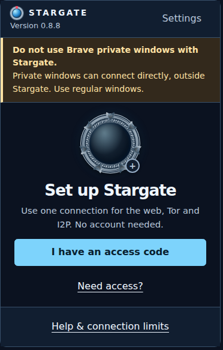
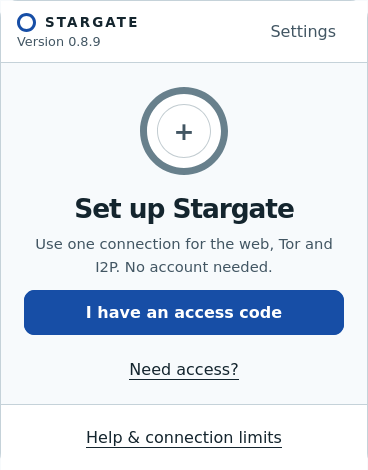
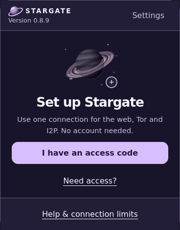
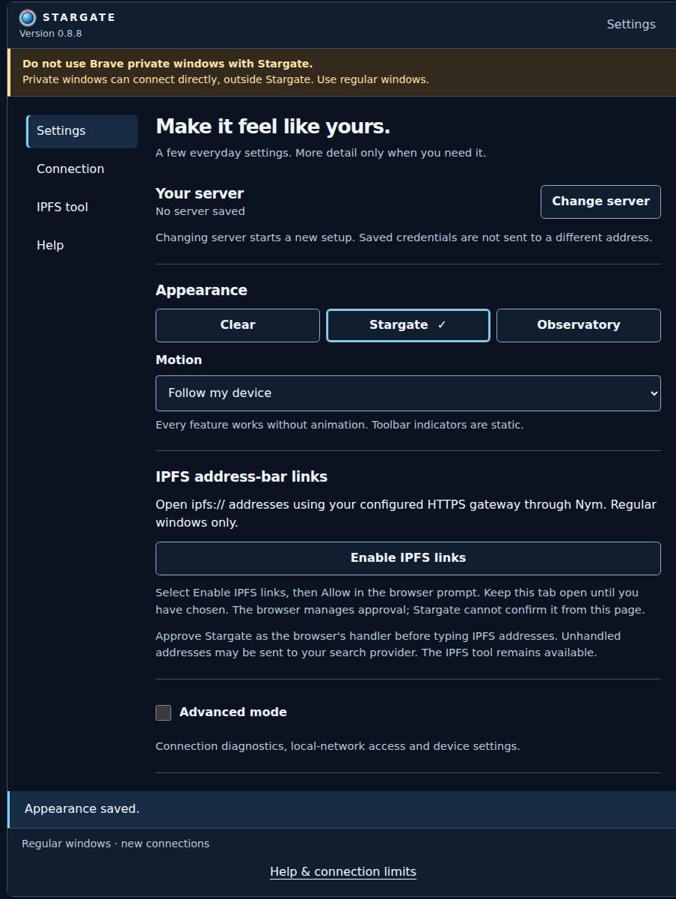
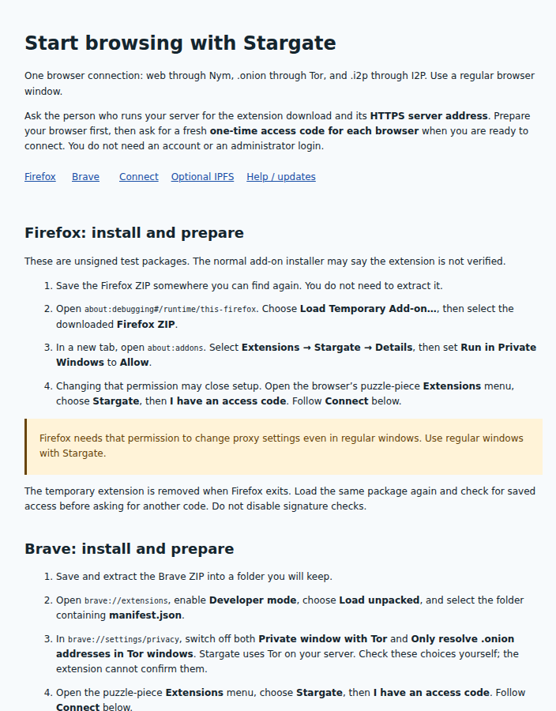

# Stargate v2

Browse ordinary websites, `.onion` sites and `.i2p` sites from Firefox or Brave.
Stargate connects your browser to a server that routes each address through the
right network. You use your normal address bar.

## Start here

| What do you want to do? | Your next step |
| --- | --- |
| Use a server someone runs for you | [Set up Firefox or Brave](docs/getting-started.md) |
| Run a server for yourself, friends or family | [Set up a Stargate server](docs/operator-guide.md#1-prepare-a-deployment) |

**Using someone else's server?** Get the extension files and HTTPS server address
from its operator. Follow the browser setup first, then ask for a fresh one-time
access code when you are ready to connect. You do not need an administrator login
or SSH.

**Use regular browser windows.** Firefox needs **Run in Private Windows → Allow**
to apply Stargate's settings even in regular windows. That permission does not
make private browsing supported. Brave private windows can connect outside Stargate.

## Downloads

[Open the v0.1.0-rc.3 downloads](https://github.com/zcat-app/stargate-v2/releases/tag/v0.1.0-rc.3)
— a testing prerelease for Linux amd64. The GitHub extension packages are
version **0.8.8**; Firefox **0.8.9** is available from Mozilla Add-ons.

- **Firefox:** install from
  [Mozilla Add-ons](https://addons.mozilla.org/en-US/firefox/addon/stargate-browser-proxy/)
  (signed **0.8.9**, permanent install, automatic updates), or load the RC's
  unsigned `stargate-firefox.xpi` (**0.8.8**) temporarily using the
  [Firefox instructions](docs/getting-started.md#firefox).
- **Brave:** `stargate-brave.zip` — extract it and follow the
  [Brave instructions](docs/getting-started.md#brave).
- **Server operators:** get `stargate-operator-v0.1.0-rc.3.tar.gz` from the same
  release, verify it, unpack it and follow `START-HERE.md`. Images are included
  as separate downloads.

Before installing or using any release files, [verify the signed downloads](docs/release-readiness.md#verify-the-downloads).
This includes the Firefox and Brave extension packages.

Firefox is published on
[Mozilla Add-ons](https://addons.mozilla.org/en-US/firefox/addon/stargate-browser-proxy/):
a Mozilla-signed permanent-install package with automatic updates. The GitHub
RC's XPI remains an unsigned temporary-load fallback. Brave is distributed on
GitHub with manual installation and updates. See
[downloads and verification](docs/release-readiness.md).

Linux amd64 is the qualified deployment/browser platform; other systems are not
qualified by these records.
Automatic prerequisite installation currently supports Ubuntu 24.04 amd64;
other Linux hosts need [manual prerequisite setup](docs/setup-prerequisites.md).

## Easy to use

Once the extension is installed, open Stargate and choose **I have an access code**.
Follow the setup steps, then browse from your usual address bar.

[Get started with Firefox or Brave →](docs/getting-started.md)

## Make it yours

Pick **Clear**, **Stargate** or **Observatory** in **Settings → Appearance**.
Themes change the look; your saved access and routes stay the same.

| Clear | Stargate | Observatory |
| --- | --- | --- |
|  |  |  |

Open **Settings** for appearance, motion and optional features. Advanced mode
can stay off until you need it.

[Customize Stargate →](docs/customization.md)

## Guided setup

The setup page walks you through preparing your browser and connecting.
A Firefox/Brave quick-start is built in, so the steps are there when you need them.

[Follow the setup and find help →](docs/onboarding.md)

*Screens shown before connecting to a server.*

## Where your traffic goes

| Address | Network |
| --- | --- |
| Ordinary websites | Nym mixnet |
| `.onion` | Tor |
| `.i2p`, including `.b32.i2p` | I2P |
| IPFS, after [optional setup](docs/user-guide.md#optional-open-ipfs-addresses) | Your configured HTTPS gateway through Nym |

An unavailable route fails instead of switching networks or connecting directly.

## Know the privacy limits

- Your server operator remains trusted: they can see routing information and
  unencrypted HTTP content. HTTPS content stays encrypted to the destination.
- Nym's client identity is shared between devices. Website logins, cookies and
  browser fingerprints remain outside network/device isolation.

Read the [privacy explanation](docs/user-guide.md#what-privacy-this-provides)
before relying on Stargate.

## Need help?

[Browser connection problems](docs/user-guide.md#if-something-does-not-work) ·
[Server diagnosis and maintenance](docs/operator-guide.md#4-routine-operation-and-diagnosis)

Developer and release reference

- [Setup wizard](docs/operator-setup-wizard.md) and [prerequisite checks](docs/setup-prerequisites.md).
- [Container setup](containers/README.md), [native builds](docs/native-build-tools.md) and [image preparation](docs/image-input-preparation.md).
- [Downloads and verification](docs/release-readiness.md), [extension packaging](docs/extension-packaging.md) and [CI checks](docs/continuous-integration.md).
- [Security findings and coverage](docs/simplex-alert-security-review.md).
- [Screenshot details and credits](docs/media/readme/README.md).

The main stack is Java 25, Quarkus and Netty. Proxy and manager run as separate
JVMs in one app container; Tor, I2P and Nym each have a container. The manager is
JavaScript-free. Operator tools use Java/Bash. Included operator JARs need no
Maven rebuild just to run the supplied tools.

Verify each release with its own checksum file and signature. The signed image
updater manifest is separate from archive verification. Follow the release and
operator guides before replacing running tools or images.

Licensed under [Apache-2.0](LICENSES/Apache-2.0.txt), with component notices preserved.
