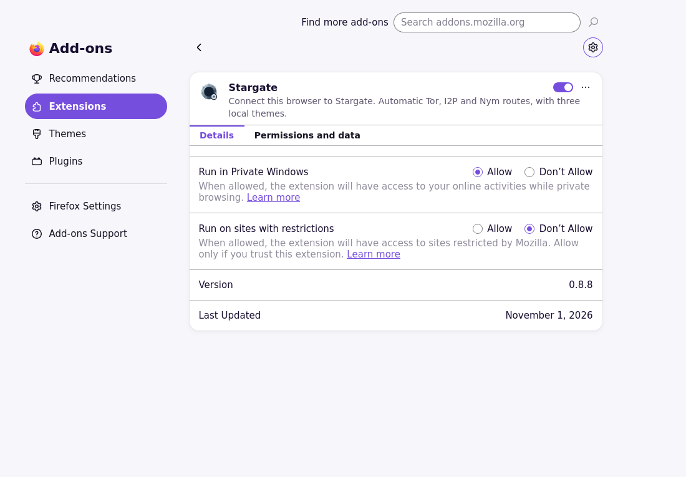
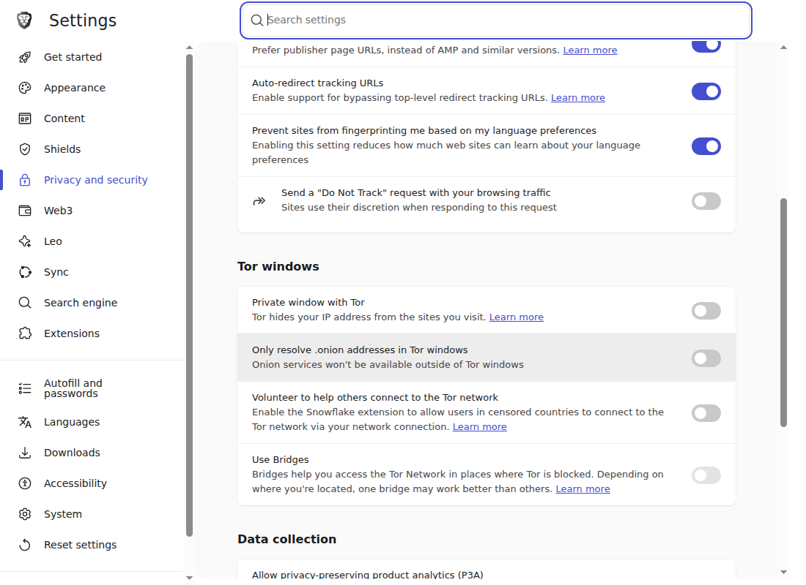

# Get started with Stargate

Connect Firefox or Brave to a Stargate server, then browse from your normal
address bar. You do not need an account, administrator login, SSH or a VPN.
Use a server operator you trust: [read the privacy limits](user-guide.md#what-privacy-this-provides).

[Firefox](#firefox) · [Brave](#brave) · [Connect](#connect-to-your-server) ·
[Back to README](../README.md)

The pictures show the English-language browsers on Linux. Your screen may look
a little different. Select any picture to see it full size.

## Before you begin

Ask your operator for the extension files and the **HTTPS Stargate server
address**, including its port. The server address and download link can differ.
[Verify downloaded files](release-readiness.md#verify-the-downloads) before installation.
Setup gets the proxy endpoint from the server; you do not enter a separate proxy port.
Prepare your browser first, then ask for a fresh one-time code when ready to connect.

Each browser, profile and device needs its own code. Do not copy saved access
between them. You never need the operator's administrator token.

## Firefox

Install from
[Mozilla Add-ons](https://addons.mozilla.org/en-US/firefox/addon/stargate-browser-proxy/)
for a normal, signed installation that stays across restarts and updates
itself. Then set the private-windows permission described below and continue
with [Connect](#connect-to-your-server).

The public v0.1.0-rc.3 GitHub release also provides extension version **0.8.8**
as `stargate-firefox.xpi`, a ZIP-format add-on for temporary loading. The GitHub
RC's XPI is unsigned by Mozilla, so its normal installer may say it is not
verified. Use temporary loading below; do not disable signature checks.

1. Save the package somewhere you can find again. If clicking the link opens the
   normal installer, use **Save Link As…** instead. Do not extract the package.
2. Enter `about:debugging#/runtime/this-firefox` in Firefox's address bar.
3. Choose **Load Temporary Add-on…** and select the saved package.

*Look for **Load Temporary Add-on…** under **Temporary Extensions**. You do not
need the Inspect buttons.*

4. Open `about:addons`. Choose **Extensions → Stargate → Details** and set
   **Run in Private Windows** to **Allow**. Firefox needs this permission even
   for regular-window settings. Continue using regular windows.
5. If setup closes after the permission change, open the browser's Extensions
   menu, choose **Stargate**, then **I have an access code**.

*Check the **Run in Private Windows** row: **Allow** should be selected.
You can leave **Run on sites with restrictions** unchanged.*

The temporary add-on disappears when Firefox fully exits. Load the same package
again into the same profile and check for saved access before requesting another
code. While the extension is absent, it cannot provide Stargate routing.

## Brave

Brave distribution stays on GitHub. The public RC ZIP is extension version
**0.8.8**. Install it manually below;
there is no Chrome Web Store listing or automatic update channel. For later
packages, follow the [manual-update steps](user-guide.md#update-or-return-after-a-restart).

1. Save `stargate-brave.zip` and extract it into a folder you will keep. The folder
   must contain `manifest.json` directly.
2. Open `brave://extensions`, enable **Developer mode**, choose **Load unpacked**
   and select that folder, not the ZIP or a folder above it.

*Turn on **Developer mode** at the top right to reveal **Load unpacked** at the
top left. After loading your folder, a **Stargate** card appears.*

3. Open `brave://settings/privacy` and scroll to **Tor windows**. First switch off
   **Only resolve .onion addresses in Tor windows**, then **Private window with Tor**.
   Both switches should be off (grey). Stargate uses Tor on your server;
   check these settings yourself.

*Your first two switches should match this picture: both **off**. Stargate cannot
check these Brave settings for you.*

4. Open the browser's Extensions menu, choose **Stargate**, then
   **I have an access code**.

Use regular windows. Brave private windows can connect outside Stargate; the
extension's warning does not block that traffic.

## Connect to your server

1. On **Set up this browser**, finish **1. Prepare your browser**.
2. Ask the operator for a fresh code. Under **2. Connect this browser**, enter the
   HTTPS server address and code, then choose **Connect this browser**. Do not
   enter an administrator token. If asked to save the code as a password, choose
   **Not now**: it is single-use.
3. Review **3. Browser settings applied** and check the server address. If access
   was saved but settings failed, finish the reported browser step and choose
   **Apply browser settings**. You do not need another code for that.
4. Fully quit and reopen the browser before sensitive browsing. In Firefox, if
   the extension was loaded temporarily, load the same package again. Check
   that Stargate uses its saved access
   and its settings are on. Existing connections can otherwise keep their old route.
5. Open a page from the normal address bar. Applied settings alone do not prove
   that a website or network is reachable.

Codes expire after **five minutes by default**, or **24 hours** if the operator
chose that option. Expiry does not end access already saved in your browser.
An expired or used code needs a fresh replacement; do not repeatedly retry it.
If pairing's result is unknown, ask the operator to check before trying again.

## What next?

- [Make Stargate look the way you like](customization.md).
- [Find the setup steps and help inside the extension](onboarding.md).
- [Read everyday controls, IPFS setup and troubleshooting](user-guide.md).

[Screenshot versions and details](media/getting-started/README.md).
