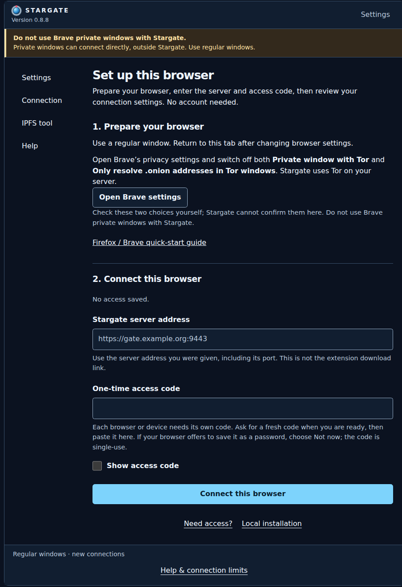
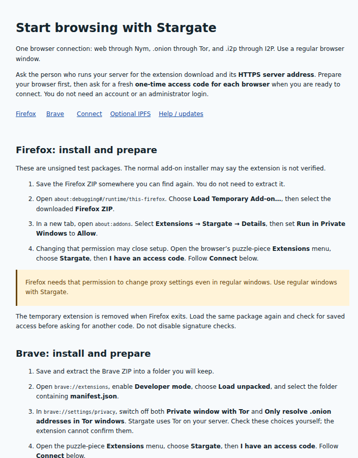

# A guide inside the extension

Stargate helps you set up the browser before you start browsing. You can also
open its Firefox/Brave quick-start whenever you need the steps again.

[Install and connect](getting-started.md) · [Back to README](../README.md)

## Follow the setup page

Choose **I have an access code** in the popup. **Set up this browser** takes you
through three steps:

1. **Prepare your browser.** Follow your browser's permission and setting checks.
   Firefox needs **Run in Private Windows → Allow** for regular-window proxy
   settings. In Brave, check the two Tor-window options yourself. Private windows
   remain unsupported; Brave private windows can connect outside Stargate.
2. **Connect this browser.** Enter your operator's HTTPS server address and a fresh
   one-time code. Do not use the download URL or an administrator token. Decline
   any offer to save the one-time code as a password.
3. **Review the applied settings.** Check the server address and preparation note.
   Saved access remains valid after the one-time code expires.

The address shown is an example; use the address your operator gives you.
This screen is before pairing. The final review appears after settings have
been applied. Fully quit and reopen the browser before sensitive browsing; in
Firefox, load the same temporary package again. Existing connections can keep
their old route until closed. Then open a page to check access: applied settings
are separate from destination reachability.

## Open the built-in quick-start

From the popup, choose **Help & connection limits**. Open
**Open the Firefox / Brave quick-start guide** from the Help page.
The setup page also has a **Firefox / Brave quick-start guide** link.

The guide includes browser preparation, connecting, optional IPFS setup and
help with codes, certificates, disconnecting and updates. It is bundled locally
with the extension and loads no external resources.

## If you get stuck

- **Expired or used code:** ask for a fresh code for this browser. Codes last five
  minutes by default, or 24 hours if the operator chose that option.
- **Access saved, but settings need attention:** finish the indicated browser step
  and use **Apply browser settings**, without redeeming another code.
- **Pairing result unknown:** stop retrying. Ask the operator to check for an unused
  device before issuing another code; the earlier request may have succeeded.
- **Certificate or server error:** contact the operator. Keep Stargate's settings
  on while diagnosing; do not bypass certificate warnings or switch to direct
  access as a repair.

See the [full troubleshooting guide](user-guide.md#if-something-does-not-work)
for other cases. Do not share codes, saved credentials or administrator tokens in
screenshots or logs.
