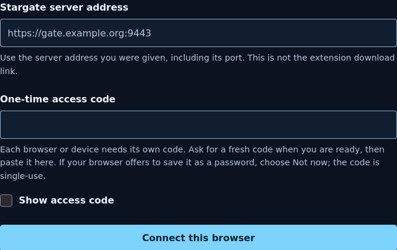
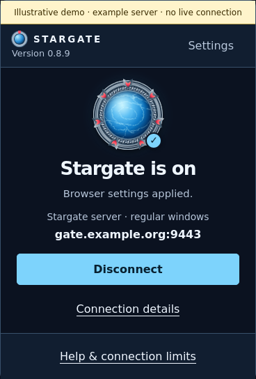
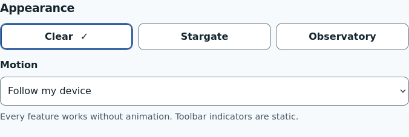
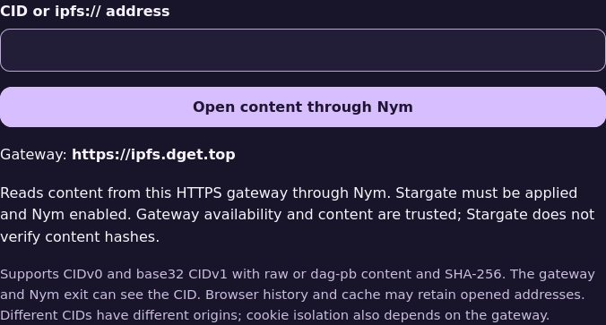

# Stargate user guide

For the Stargate extension on Linux Firefox and Brave.
Start here if someone else runs your Stargate server. You do not need an account,
a manager login, SSH, a VPN or a certificate import for the remote HTTPS setup.

[Install](#1-get-ready) · [Connect](#2-connect-once) ·
[Everyday controls](#3-everyday-controls) · [IPFS](#optional-open-ipfs-addresses) ·
[Help and updates](#if-something-does-not-work) · [Privacy](#what-privacy-this-provides)

Stargate connects this browser to your operator's server. Use the browser's normal
address bar and links; you do not need to enter websites inside the extension.

| Address you open | Route |
| --- | --- |
| An ordinary website | Nym mixnet |
| An address ending in `.onion` | Tor |
| An address ending in `.i2p`, including `.b32.i2p` | I2P |
| `ipfs://…`, after optional setup below | Your configured HTTPS gateway through Nym |

Your operator must enable the corresponding routes. When a route is unavailable,
Stargate does not send that request through a different network or directly.
Use **regular browser windows**. Private windows are unsupported; Brave private
windows can connect outside Stargate.

## 1. Get ready

Ask the person who runs your server for:

- The Firefox or Brave extension download and its installation instructions.
- The **HTTPS Stargate server address**, including any port, such as
  `https://gate.example.org:9443`. Use the address they give you, not this example.
- A **fresh one-time access code**, once you have finished preparing the browser.

The download address and server address may differ. You do not enter a separate
proxy port; setup gets it from the server. Never enter the operator's administrator
token in Stargate, a website or a browser proxy-password prompt.

A separate browser profile is useful for keeping Stargate browsing apart from
your other browsing. Stargate affects regular tabs in the profile where it is
installed, not other applications. Firefox, Brave, another profile and another
device each need their own access code. Do not copy saved access between them.

### Install in Firefox

Install from
[Mozilla Add-ons](https://addons.mozilla.org/en-US/firefox/addon/stargate-browser-proxy/)
for a normal, signed installation that stays across restarts and updates
itself; then set the private-windows permission in step 4 and continue
connecting below.

These steps cover the public GitHub v0.1.0-rc.3 **Firefox 0.8.8** package,
which is unsigned by Mozilla: normal installation of the RC can report that
the add-on is not verified, and a temporary add-on must be loaded again after
every Firefox restart. Use temporary loading below; do not disable signature
checks.

1. Save the Firefox XPI somewhere you can find again. If the download opens the
   normal installer, use **Save Link As…**. You do not need to extract the XPI.
2. Enter `about:debugging#/runtime/this-firefox` in Firefox's address bar.
3. Choose **Load Temporary Add-on…**, then select the saved Firefox XPI.
4. In a new tab, open `about:addons`. Select **Extensions → Stargate → Details**.
   Set **Run in Private Windows** to **Allow**. Firefox requires this permission
   to change proxy settings even in regular windows; continue using regular windows.
5. Changing that permission may close setup. Open the puzzle-piece **Extensions**
   menu, choose **Stargate**, then **I have an access code**.

The temporary extension is removed when Firefox fully exits. To return, load the
same XPI again and check for saved access before asking for another code. While
the extension is absent, it cannot provide Stargate's routing protection.

### Install in Brave

1. Save the Brave ZIP. Extract it with your file manager into a folder you will
   keep. The folder you select next must contain `manifest.json` directly.
2. Open `brave://extensions`. Enable **Developer mode**, choose **Load unpacked**,
   and select that folder, not the ZIP or a folder above it.
3. Open `brave://settings/privacy`. Under **Tor windows**, switch off both
   **Private window with Tor** and **Only resolve .onion addresses in Tor windows**.
   Stargate uses Tor on your server, separately from Brave's built-in Tor.
4. Open the puzzle-piece **Extensions** menu, choose **Stargate**, then
   **I have an access code**.

Use regular windows. Allowing the extension in private windows has not been
verified as protection. The private-window warning does not block that traffic.

## 2. Connect once

1. On **Set up this browser**, finish **1. Prepare your browser**. In Brave, check
   the two Tor settings yourself; Stargate cannot confirm them automatically.
2. Ask the operator for a fresh code. Under **2. Connect this browser**, paste the
   server address and code. Choose **Connect this browser**. If Firefox offers
   to save the code as a password, choose **Not now**; it is single-use.
3. Review **3. Browser settings applied**. Check the server address and preparation
   note. If access was saved but settings failed, complete the indicated browser
   step and use **Apply browser settings**. You do not need another code for this.
4. Fully quit and reopen the browser before sensitive browsing. In Firefox,
   reload the same XPI only if you installed it temporarily. Open Stargate and
   check that its settings are on.
5. Open a website from the normal address bar. Applied settings do not prove that
   a website or every network is currently reachable.

Codes are single-use and expire after **five minutes by default**, or **24 hours**
if the operator selected that option. Once saved, browser access does not end when
the code expires. It remains usable unless revoked or its configuration changes.
You do not need a new code for every visit or ordinary restart.

  

*Setup before pairing; the address shown is a placeholder.*

## 3. Everyday controls

Select Stargate in the Extensions menu to open its small popup. **Settings** opens
a full tab. The installed version appears in the header of both views.

| What you see | What it means / what to do |
| --- | --- |
| **Stargate is on** | Browser settings are confirmed for regular windows. Website access is a separate check. |
| **Stargate is off** | Previous browser settings are in use and may connect directly. **Connect** reuses saved access. |
| **Updating browser settings…** | Wait briefly, then reopen the popup to check the result. |
| **Settings are on** with server status unavailable | Keep settings on; inspect **Connection details** or contact the operator. Status failure alone does not prove forwarding stopped. |
| **Settings need attention** / **Settings are not confirmed** | Read the message before browsing. Another extension or browser policy may control a required setting. |
| **One network needs attention** | Check that route's observation; other networks may still work. |

  

*Illustrative connected state with a fictional server; this is not a live
connection or a network test.*

The toolbar icon, badge and tooltip reflect these settings states. They are not
proof that a destination is reachable. A listening port or a past successful
response is also not a current access test. **Connection → Refresh observations**
shows the latest available information and its age.

### Disconnect without losing access

Choose **Disconnect**. The confirmation has **Stay connected** to cancel and
**Disconnect** to proceed. Saved access is kept, and **Connect** can reuse it.
New connections use your previous browser settings, which may connect directly.
Existing connections can keep their previous route until closed. This does not
stop the shared server or disconnect other devices.

If you want to end already-open traffic, close those connections or fully quit
the browser. Do not choose Disconnect as a repair for an outage when you intend
to keep browsing through Stargate.

### Appearance and advanced settings

**Settings → Appearance** offers **Clear**, **Stargate** and **Observatory**.
They change appearance only, using local assets. **Motion → Reduce motion** works
with every theme. The toolbar indicators are static.

  

Leave **Advanced mode** off unless you need one of these controls:

- **Direct local-network access**: off by default. Turning it on lets new requests
  to literal private IPv4 addresses, including equivalent IPv4-mapped IPv6 forms,
  connect directly from this browser. It does not discover local devices or make
  local hostnames work. This is a deliberate exception to Stargate routing.
- **IPFS gateway**: change the compatible HTTPS gateway used for new IPFS opens.
- **Saved device access**: see your device identifier, replace access, or choose
  **Disconnect and forget saved access**. Forgetting local access does not revoke
  it on the server. Ask the operator to revoke it if a device is lost or exposed.

## Optional: open IPFS addresses

Skip this for ordinary browsing. Start with **Settings → IPFS address-bar links**.

**Firefox:** when asked to open an IPFS link with Stargate, accept **Open Link**.
If it offers **System Handler**, cancel. Open `about:preferences#downloads`, find
**ipfs** under **Files and applications**, and select
**Use Stargate IPFS through Nym**. Retry. If Stargate is absent, ask for help;
keep saved access and do not select an external application or reset the profile.

**Brave:** choose **Enable IPFS links**, then **Allow** in the browser prompt.
Keep the tab open until approval. If needed, inspect `brave://settings/handlers`.

Approve the handler before typing an `ipfs://` address; otherwise the browser may
send it to a search provider. After setup, use the normal address bar. The
**IPFS tool** also accepts a CID or IPFS address and opens content in a new tab.

  

*The tool before entering an address. Saved access and applied settings are
required before opening content.*

Content comes from the selected HTTPS gateway through Nym. Stargate does not run
a local IPFS node, publish content, support IPNS or independently verify content
hashes. Supported inputs are CIDv0 and lowercase base32 CIDv1 raw/dag-pb with
SHA-256. The gateway and Nym exit can see the CID; browser history/cache can retain
opened addresses. A public gateway can be slow or unavailable.

For an operator-supplied alternative, enable **Advanced mode → IPFS gateway**.
Use a compatible HTTPS subdomain base: `https://ipfs.example.org` produces
`https://CID.ipfs.example.org/path`. A URL containing `/ipfs/` is not accepted.
Saving a gateway affects new opens, not existing tabs.

## If something does not work

| Problem | Next step |
| --- | --- |
| **Code invalid, expired or already used** | Ask for a fresh code for this browser. Do not reuse another browser's code. |
| **Pairing result unknown** | Stop retrying that code. Ask the operator to check for an unused device and issue a replacement. The earlier request may already have saved access on the server. |
| **Access saved. Finish setup.** | Complete the reported permission/setting step, then apply browser settings without another code. |
| **Access wasn’t accepted** | Ask the operator to check revocation/configuration and provide new access if appropriate. Cancel native proxy-password prompts; never enter an administrator token there. |
| An I2P page is slow on first use | A cold route can take minutes. Wait, check **Connection** observations, then retry only when safe. Silent open connections keep that device's route running. |
| Brave blocks an onion page | Check both Brave Tor settings above. If already off, ask for help; `ERR_BLOCKED_BY_CLIENT` alone does not identify the cause. |
| A certificate warning or proxy-certificate error | Check the address with the operator. Do not bypass the warning, import an unknown certificate or switch to direct access as a repair. |
| A page times out / Nym is unavailable | Keep settings on and inspect observations. Tell the operator which route failed, browser/extension versions, error and approximate time. Ordinary web has no Tor/direct fallback. |
| An IPFS address opens a search or System Handler | Complete the browser-specific handler setup above. Re-pairing is not the remedy. |

Do not repeatedly resubmit payments, forms or uploads after a timeout: they may
already have reached the destination. Share a full URL with the operator only if
necessary and acceptable to you; it may contain private information. Never send
access codes, saved credentials or administrator secrets in screenshots/logs.

### Update or return after a restart

Firefox installations from
[Mozilla Add-ons](https://addons.mozilla.org/en-US/firefox/addon/stargate-browser-proxy/)
update automatically. For the GitHub packages, obtain updates from your
operator or the project's GitHub releases and
[verify the downloads](release-readiness.md#verify-the-downloads). The public
v0.1.0-rc.3 packages are 0.8.8. Do not uninstall or clear extension data as a
routine update step.

- **Firefox (temporary loading):** replace the saved XPI at the same location,
  fully quit and reopen Firefox, then use **Load Temporary Add-on…** to load
  that XPI. Check saved access and the version in Stargate.
- **Brave:** replace files in the same extracted folder, then use **Reload** on
  Stargate's `brave://extensions` card. Check the version and settings.

Fully restart after applying settings before sensitive browsing. A new profile,
removed data or revoked access can require a new code. The temporary-loading
steps apply to the unsigned GitHub Firefox XPI; the Add-ons install updates
itself. Brave updates are manual.

## What privacy this provides

Read the [extension privacy policy](privacy-policy.md) for data recipients,
local/server records, retention and deletion. Source version 0.8.9 also includes
it offline under Setup and Help; the released RC remains 0.8.8.

The remote HTTPS connection encrypts transport between your browser and the
Stargate server. The operator does not need to give you its certificate key.
For a destination using HTTPS, that website connection stays encrypted through
Stargate to the destination. For HTTP, the VPS can read the content before sending
it into the selected network. A compromised VPS can inspect HTTP content, access
credentials and routing metadata. Only use a server/operator you trust.

Each paired device has separate credentials. Tor separates by device credential,
not by website. In the isolated I2P deployment, each credential has its own
persistent destination identity, but shares the router/host. Nym uses one shared
client; separate streams do not give each user an independent Nym identity.
Copying saved access copies its identity; it is not tied to a particular machine.

Stargate does not remove cookies, website logins or browser fingerprints. The
browser may resolve the Stargate server's own hostname outside the proxy, and
loopback/the configured server API remain routing exceptions. It does not protect
other applications, promise every DNS request is contained, or provide a universal
kill switch when the extension is absent, disabled or its settings fail. WebRTC
restrictions may prevent calls from working. Private windows remain unsupported.

For quick installation steps, use the locally bundled
[Firefox / Brave quick-start](../extension/src/quick-start.html). For server work,
use the separate [operator guide](operator-guide.md).
